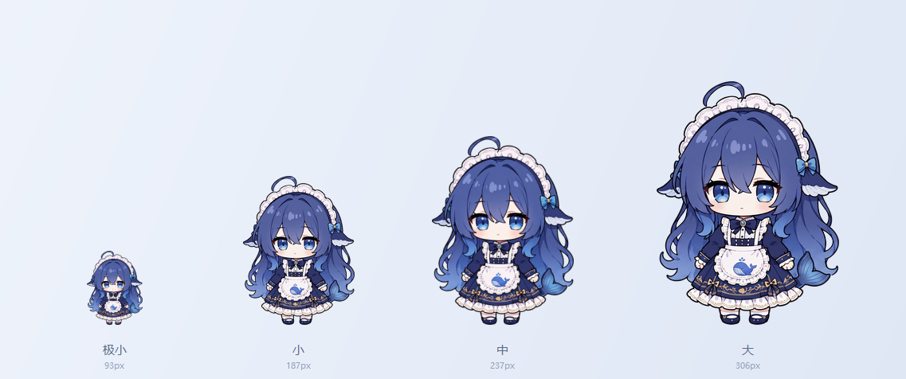
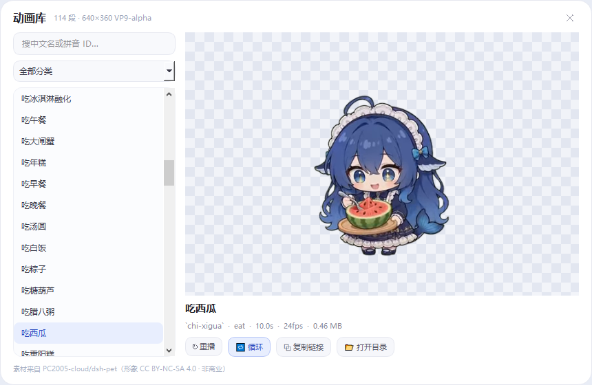

# 大肥鱼桌宠 · DaFeiYu Desk Pet 🐋


一只常驻 Windows 桌面的透明鲸鱼娘：待在原地陪着你、跟你聊天、记住你说过的话、催你干今天的活，没人搭理的时候还会主动唠叨两句。纯本地运行，AI 后端可接 DeepSeek / Agnes AI / 任意 OpenAI 兼容接口，Key 与聊天记录全部留在本机。

A transparent anime-style desktop pet for Windows. She stays wherever you put her, plays her own animations, chats with you, remembers what you said, nags you about today's to-dos, and starts talking to herself when you ignore her. Runs fully locally — DeepSeek, Agnes AI or any OpenAI-compatible endpoint; keys and chat history never leave your machine.



## 功能一览 · Features

| 能力    | 中文                                          | English                                                                                          |
| ----- | ------------------------------------------- | ------------------------------------------------------------------------------------------------ |
| 桌面行为  | 整段透明动画驱动：待在原地，待机随机轮播，被拖起会悬空挣扎 | Full-clip transparent animation: stays put, random idle rotation, dangles when dragged |
| 互动回应  | 点一下播 6 段「点击回应」之一，到点吃饭播「吃」，下班播伸懒腰        | Six click responses, a random eating clip at lunch, a big stretch when work ends                 |
| 大小四档  | 极小 / 小 / 中 / 大，极小只有 93px（小的正好一半），气泡自动加宽加高   | Four sizes, the smallest is just 93px tall; speech bubble auto-resizes                           |
| AI 聊天 | 单击弹聊天框，接 DeepSeek / Agnes / 自定义接口，回复短句不啰嗦   | Click to chat through DeepSeek / Agnes / any OpenAI-compatible API                               |
| 办公便利贴 | 头顶便利贴记今日工作，一句话拆多条，到点提醒，下班回顾                 | Sticky-note panel for today's tasks, Chinese time parsing, reminders, end-of-day review          |
| 长期记忆  | 本地 SQLite 五层记忆 + 可塑性记忆：自动提炼、按需回忆、合并重塑与遗忘     | Five-layer local memory in SQLite with Plastic Memory: auto-extract, recall, merge, reshape, fade |
| 话唠模式  | 三档频率，按聊天与记忆主动开口，八种情绪，深夜免打扰                  | Three chatter levels, memory-driven small talk, eight moods, quiet hours                         |
| 动画库   | 114 段 640×360 透明动画（待机/吃喝/玩耍/工作/节日/睡觉/点击回应…），面板内搜索播放 | 114 transparent 640×360 clips across 12 categories, browsable and playable with real alpha        |
| 数据隔离  | Key / 工作项 / 记忆库全部不入仓库，附密钥扫描脚本               | No keys or personal data in the repo; bundled secret scanner                                     |

## 快速开始 · Quick Start

```bash
git clone https://github.com/csxqnznz-collab/dafeiyu.git
cd dafeiyu
pip install -r requirements.txt
python 桌宠.py            # 或双击「启动桌宠.bat」
```

首次运行右键桌宠 → **⚙ 接口设置** → 选服务商 → 填 Key → 测试连接 → 保存（不填 Key 也能用桌宠本身，只是不能聊天）。

Run it, right-click the pet → **⚙ API Settings** → pick a provider → paste your key → test → save. Everything except chat works without a key.

## 功能（详细说明 · 中文）

- **动画驱动**：桌宠本体就是一段段 640×360 的透明动画，不再用固定的正/侧/背三视图
  | 场景 | 播什么 | 说明 |
  | --- | --- | --- |
  | 待机 | 5 段「待机」随机轮播 | 每 11-21 秒换一段，同一段不连着播 |
  | 单击 | 6 段「点击回应」随机一段 | 元气挥手 / 开心跃动 / 害羞惊讶 / 挠痒咯咯笑 / 傲娇生气 |
  | 到点吃饭（12:00） | 10 段「吃」随机一段 | 也用于双击喂食 |
  | 下班 / 下班回顾 | 「超大伸懒腰」 | 到点先伸个懒腰，再问你今天做完没 |
  | 被拖拽 | 「被鼠标拖拽悬空反馈」 | 松手回到待机 |
- **待在原地**：她不自己走动，位置完全由你拖；拖动时播「被悬空拖拽」的挣扎动画
- **四种大小**：极小 / 小 / 中 / 大（右键 → 大小）：
  - 极小 = 小的正好一半，身高 93px，窗口自动加宽、气泡区加高、字号缩小，长句也不会糊在脸上
  - 换档时脚底位置不动，只往上长 / 往下缩
  - 所以配置里的旧尺寸（如手动改成怪值）会自动吸附到最近档位
- **互动**：
  - 左键按住：拖拽（会播「被悬空拖拽」的挣扎动画，松手会说话）
  - 单击：播「点击回应」+ 回嘴（互动台词）+ 弹出 🗨️ 聊天面板
  - 双击：喂食面板（小鱼干 / 蛋糕 / 棒棒糖 / 团子 / 钻石），选完播「吃」
  - 右键：完整菜单（大小 / AI 模型 / 话唠模式 / 喂食 / 说句话 / 显示/隐藏 / 鼠标穿透 / 置顶 / 开机自启 / 退出；托盘右键是同款菜单，穿透后可从托盘解除）
- **台词系统**：日常随机台词 + 互动回嘴 + 思维链心声（灰色斜体括号气泡，小概率冒出），全部取材自社区 DS 梗
- **细节**：片段之间 0.16 秒淡入淡出、偶尔蹦一下或伸个懒腰（带冷却）、说话冷却、藏起来就暂停解码省电
- 托盘图标、窗口置顶、鼠标穿透、开机自启、配置记忆（config.json）；穿透 / 置顶状态重启后自动恢复
- ##### 天气查询（新增）
  - 右键菜单「查看天气」→ 调用 `wttr.in` 获取当前城市天气
  - 城市默认从 `config.json` 读取，可手动修改配置文件中的 `"city"` 字段
  - 鱼会气泡播报：「汕头今天 26°，天气多云」
  ##### 系统状态监控（新增）
  - **CPU**：超过 90% 时冒泡提醒
  - **内存**：超过 95% 时冒泡提醒
  - **显卡（NVIDIA）**：温度超过 80°C 时冒泡提醒（`pynvml` 读取）
  - 检测间隔 10 秒，不频繁打扰
  ##### 办公便利贴 + 工作提醒（新增）
  - 单击桌宠 → 头顶弹出便利贴（放大动画弹出、缩小收起），再点一次即可收起
  - **上半 1/3 是今日工作**：每条格式为「时间 + 内容」，不同颜色的半透明标签区分
  - 点击某条 → 切换完成 / 未完成；已完成的文字变半透明，再点一下即重新启动
  - 右键单条 → 修改提醒时间 / 不再提醒 / 标记完成 / 删除
  - **下半是聊天窗**：既能普通聊天（走 Agnes AI），也能直接说  
    「提醒我下午两点半有重要会议」→ 自动解析成 `14:30 重要会议` 并录入
  - 也支持**一口气说一串、不带具体时间**：  
    「我下午的工作：和IT部门沟通网站事宜；广告对标；拿到物料」  
    → 拆成 3 条，时段记为「下午」，默认都在下班时间结束（点一下打勾即完成）
  - **只记真正的工作内容**，闲聊不会被误录（三道判定）：
    1. 「工作」两个字单独出现不算意图，要有清单表头（`我下午的工作：` `任务：` `今日待办：`）  
       或明确的待办词（提醒 / 记得 / 待办）
    2. 没有表头时，靠逗号拆分成多条不算清单 —— 避免一句吐槽被拆成三条待办
    3. 反问 / 感叹句（`吗` `呢` `？` `怎么` `为什么` `好累啊`）一律当聊天，  
       句中若含业务动词（沟通 / 跟进 / 对账 / 报价…）则豁免  
       例：`键盘都是粑粑 那我怎么工作，没工作怎么有钱，没钱怎么买帝王蟹` → 走 AI 聊天，不记录
  - 到点桌宠冒泡提醒；超过设定分钟数仍未处理 → 自动视为完成（默认 30 分钟，  
    无具体时间的条目除外，它们等下班回顾时由你打勾）
  - 固定日程提醒（时间、文案、开关均可在 ⚙ 里改）：  
    早上开机汇总今日工作 → 12:00 午饭 → 打卡前 5 分钟 → 13:30 上班打卡  
    → 14:00 下午待办 → 18:00 下班打卡 → 18:00 下班回顾（问今天都完成了么并列出全部条目，  
    可在聊天框回一句「都完成了」一键打勾）
  - 数据存 `work_items.json`（按日期分组，已加入 `.gitignore`）
  ##### 长期记忆（新增）
  - **聊过就不忘**：所有对话存本地 SQLite，重启、关机都不丢；下次打开它还认得你
  - **自动提炼**：累计 10 轮对话（或你说「记住…」「别忘了…」立刻）后台提取值得记的事，  
    分五类：核心记忆 / 用户画像 / 事件 / 知识 / 当前任务。普通寒暄不会被记
  - **会主动回忆**：问「你还记得我之前想做的那个项目吗」→ 自动检索相关旧事注入上下文；  
    平时闲聊只带核心记忆和画像，不塞一大堆历史（省 token）
  - **越用越懂你**：用户画像（身份、偏好、在做的事）会持续更新，旧结论标记为「已被更新」而非硬删
  - **睡眠整理**：启动 / 退出 / 手动触发——合并重复记忆、同步画像、归档过期任务、  
    低价值内容归档，全部写日志可追溯
  - **记忆中心**（右键 → 🧠 长期记忆 → 记忆中心）：概览统计、分类浏览、搜索、  
    新建 / 编辑 / 锁定 / 归档 / 删除、备份 / 导出 JSON / 恢复
  - 存储位置：`%APPDATA%\HJCDaFeiYu\database\memory.db`（**不放在程序目录**），  
    备份在 `database\backups\`，配置在程序目录 `memory-config.json`
  - 关闭记忆：右键 → 🧠 长期记忆 → 长期记忆开关（关掉即退回纯聊天，不再注入也不再记录）
  - 设计与实现见 `MEMORY_ARCHITECTURE.md`，测试结果见 `MEMORY_TEST_REPORT.md`
  ##### 接口设置（DeepSeek / Agnes / 自定义）
  - 右键 → **⚙ 接口设置**，一个面板搞定服务商、地址、Key、模型
  - 三个预设各自独立保存，切换不串 Key、不丢配置：
    | 服务商      | 默认地址                                | 预置模型                                                          |
    | -------- | ----------------------------------- | ------------------------------------------------------------- |
    | DeepSeek | `https://api.deepseek.com/v1`       | `deepseek-chat` / `deepseek-reasoner`                         |
    | Agnes AI | `https://apihub.agnes-ai.com/v1`    | `agnes-2.5-flash` / `agnes-3.0-flash` / `agnes-2.5-pro-alpha` |
    | 自定义      | 自己填（硅基流动 / 阿里百炼 / Ollama / OneAPI…） | 自己填                                                           |
  - **测试连接**：发一条最小请求，把 401 / 402 / 404 / 429 / 超时翻译成中文提示，不用猜
  - **拉取列表**：`GET /models` 直接把可用模型塞进下拉框，手懒也能选
  - 地址容错：不写 `https://` 自动补；误粘 `/v1/chat/completions` 自动截回 `/v1`
  - 模型 404 自动降级到该服务商的默认模型，并把配置改回可用值（下次不再白跑）
  - 配置存在 `config.json` 的 `ai_profiles` 下，旧版单 Key 配置启动时自动迁移
  ##### 动画库（114 段透明动画）
  - 右键 → **🎬 动画库**，左边搜索 / 分类筛选，右边直接播，棋盘格底看得出透明
  - 素材是 **640×360 的 VP9-alpha WebM**（24fps，约 10 秒，可首尾循环）+ 220×124 的 GIF 预览

  

  - 十二类：待机 / 移动 / 点击回应 / 玩耍 / 工作 / 吃 / 睡觉 / 余额 / 碎碎念 / 节日 / 特效 / 日常
  - 细节与全部动画见 **[dsh-pet/README.md](dsh-pet/README.md)** 与 **[dsh-pet/GALLERY.md](dsh-pet/GALLERY.md)**
  - 播放依赖 PyAV（`pip install av numpy`），没装时自动退回 GIF 预览；**不能用 QtMultimedia**，
    它解 VP9-alpha 会丢透明通道
  - 素材来自 [PC2005-cloud/dsh-pet](https://github.com/PC2005-cloud/dsh-pet)，
    形象为 **CC BY-NC-SA 4.0（非商业）**，授权细节见 **[dsh-pet/CREDITS.md](dsh-pet/CREDITS.md)**

## 长期记忆架构 · Memory Architecture

本项目采用一种融合**分层记忆、动态检索与可塑性记忆（Plastic Memory）**的 AI 长期记忆架构，赋予桌面 AI 宠物跨会话、跨重启的持续记忆能力。

系统以本地数据库为基础，将记忆划分为**核心记忆、用户画像、事件记忆、知识记忆和原始对话**五个层级，通过自动提取、语义检索、关联分析、记忆合并与动态更新，让 AI 不仅能够记住用户的身份、偏好、经历和共同互动，还能够像人类大脑一样，根据新的信息和长期互动不断调整、强化、修正或淡化已有记忆。

记忆不再是静态存档，而是一个具有**形成、巩固、联想、重塑和遗忘**能力的动态系统。同时，通过按需检索和上下文动态注入，AI 无需重复读取全部历史对话，就能在有限的 Context Window 中保持记忆的连续性与准确性，实现**低 Token 消耗、长期个性化和持续进化**的 AI 陪伴体验。

> This project implements a long-term memory architecture that fuses **layered memory, dynamic retrieval and Plastic Memory**, giving the desktop pet memory that survives across sessions and restarts. Memories are organised into five layers — core memory, user profile, episodic memory, knowledge memory and raw dialogue — and are continuously extracted, semantically retrieved, associated, merged and updated, so the AI not only remembers who you are, what you prefer and what you have been through together, but also strengthens, corrects or gradually fades old memories the way a human brain does. Memory is no longer a static archive but a dynamic system capable of formation, consolidation, association, reshaping and forgetting. With on-demand retrieval and context injection, the AI keeps continuity and accuracy inside a limited context window — low token cost, long-term personalisation, continuously evolving companionship.

## 接口配置（给新装的人）

```bash
cp config.example.json config.json   # 然后把 key 填进去
```

`config.json` 结构与说明：

```jsonc
{
  "ai_provider": "agnes",            // 当前用哪家：deepseek / agnes / custom
  "ai_profiles": {
    "deepseek": { "key": "", "base": "https://api.deepseek.com/v1", "model": "deepseek-chat" },
    "agnes":    { "key": "", "base": "https://apihub.agnes-ai.com/v1", "model": "agnes-2.5-flash" },
    "custom":   { "key": "", "base": "", "model": "" }
  },
  "city": "广州"
}
```

也可以完全不碰文件：启动后右键 → 接口设置 → 填 Key → 保存。

## 数据隔离（上传 / 分享前必读）

这个项目会读写你的 Key、聊天记录和作息，仓库里**不含任何个人数据**：

| 数据             | 位置                                        | 是否进仓库           |
| -------------- | ----------------------------------------- | --------------- |
| API Key / 接口配置 | `config.json`                             | 否（`.gitignore`） |
| 今日工作 / 提醒      | `work_items.json`                         | 否               |
| 话唠计数与最近台词      | `chatter_state.json`                      | 否               |
| 长期记忆库          | `%APPDATA%\HJCDaFeiYu\database\memory.db` | 否（本就在用户目录）      |
| 记忆备份           | `%APPDATA%\HJCDaFeiYu\database\backups\`  | 否               |
| 错误日志           | `ai_error.log`                            | 否               |

提交前自查（自带密钥扫描，能识别 `sk-…`、GitHub Token、AWS Key、私钥头、JSON 明文凭据）：

```bash
python scripts/check_secrets.py             # 只扫「会被提交的文件」
python scripts/check_secrets.py --history   # 连 git 历史一起扫
python scripts/check_secrets.py --install-hook   # 装成 pre-commit，有密钥直接拦下
```

已经装了钩子的话，`git commit` 时发现疑似密钥会中止提交；  
确认是误报可 `git commit --no-verify` 跳过。

万一 Key 曾经提交过：**先吊销再清理历史**（`git filter-repo --path config.json --invert-paths`），  
不要只删文件——旧 commit 里还在。

##### 话唠模式（新增）

- 右键 → **🗣 话唠模式**，四档：关闭 / 1 级 / 2 级 / 3 级
  | 档位  | 频率           | 平均间隔     |
  | --- | ------------ | -------- |
  | 1 级 | 3 小时 5-10 条  | 18-36 分钟 |
  | 2 级 | 2 小时 10-20 条 | 6-12 分钟  |
  | 3 级 | 1 小时 20-30 条 | 2-3 分钟   |
- **有料才开口**：素材来自最近聊天、长期记忆、今日待办、用户画像；  
  一条都没有就跳过这一轮，不硬编故事、不假装记得没发生的事
- **八种情绪**按素材加权随机：好奇追问 / 抱怨 / 伤心 / 开心 / 无聊 / 担忧 / 思念 / 兴奋  
  （有没做完的活 → 更爱抱怨和担忧；你刚说过话 → 更爱追问；有旧记忆 → 更爱念叨）
- **台词跟记忆挂钩**：优先让 AI 按素材现写（一次生成 3 句备用，省请求），  
  例如「下午找IT谈网站，别冷落了鱼鱼」「等肯尼亚回款，咱们一起乐」；  
  没 Key 或接口挂了就用本地模板，把素材关键词填进句子
- **不烦人**：深夜 23:00-08:00 免打扰、你聊天后 3 分钟内不插嘴、  
  滚动窗口卡上限（3 级满 30 条/小时就停到最早的滚出去）
- 今日计数存在 `chatter_state.json`，菜单里能看到「今天已经念叨 N 句」；  
  「现在说一句（试试）」可以立刻看效果
- 参数：`config.json` 的 `chatter_level`（0-3）、`chatter_quiet`（免打扰时段，如 `["23:00","08:00"]`）

##### 动画驱动（新增）

- **不再用三视图**：新版素材（`dsh-pet/`）只有整套动画，没有正面 / 侧面 / 背面三张图，
  所以桌宠本体直接由动画驱动；旧的 `sprites/` 只在没装 PyAV 的机器上兜底
- **语义层 `pet_anim.ROLE_CLIPS`**：桌宠只认「待机 / 点击 / 吃 / 伸懒腰 / 被拖」五个角色，
  每个角色对应一组动画 id，随机挑一段；想换某类动作用哪几段，改这张表即可，主程序不用动
- **固定舞台裁剪**：素材是 640×360，角色只占中间约 220×276，两边全是透明留白。
  程序用同一个裁剪框（`STAGE = 150, 8, 340, 340`）和同一个缩放比（`cur_h / 276`）去裁去缩，
  所以换片段时角色大小、站位、脚底线都不会跳
- **每段动画的包围盒**：`dsh-pet/assets/bbox.json` 由 `scripts/build_anim_bbox.py` 扫描生成
  （每段取 18 帧采样、alpha > 12 的并集），用来保证选进角色的片段不会被裁到
- **性能**：640×360 VP9 解码 + 24fps 播放，本机（i3-10100T）实测常驻 **5-10% 单核**、内存约 120MB；
  只在新帧到达时重绘（不再 50fps 空刷），裁剪缩放每帧只算一次并缓存，窗口隐藏时停解码器
- **降级**：没装 PyAV → 退回 `sprites/` 里的「正面」一张静图（只剩呼吸 / 摇摆 / 蹦跳），
  动画和朝向都不用；连 `dsh-pet/` 素材都没有也一样能跑

## 本版没有的东西

- **没有「模式」**：1.6.0 起删掉了右键菜单里的「模式」（自由散步 / 横向行走 / 跟随鼠标 / 原地待着），
  也删掉了走路、跑步、跟随鼠标这些自动移动行为——桌宠就待在原地播动画，位置全靠拖。
  以前配置里残留的 `"mode"` 字段启动时会被自动丢掉，不影响使用。
  对应的走 / 跑动画（`yuandi-piaofu-tabu`、`pangxie-zoulu`、`kai-xin-xiao-pao`）仍留在素材库里，
  只是不再接进角色表，想要回来改 `pet_anim.ROLE_CLIPS` 就能加。

## 运行

需要 **Python 3.11+**

```bash
pip install -r requirements.txt
# 或
pip install PySide6
```

然后双击 `启动桌宠.bat`，或：

```bash
python 桌宠.py
```

## 打包成独立 exe（可分享给朋友）

```bash
pip install pyinstaller
pyinstaller --noconfirm --onefile --windowed --name 大肥鱼桌宠 ^
  --add-data "sprites;sprites" --add-data "dsh-pet/assets;dsh-pet/assets" ^
  --icon icon.ico 桌宠.py
```

产物在 `dist/大肥鱼桌宠.exe`，对方双击即用，无需安装 Python。  
打包后要能播动画，还得把 PyAV 一起带上：`pip install av`（不加也能跑，只是退回三视图）。  
（杀毒软件可能对 PyInstaller 产物误报，加信任即可。）

## 更换形象

**推荐：换动画**（新版素材就是这个路子）

1. 把 640×360 的 VP9-alpha webm 放进 `dsh-pet/assets/webm/`，GIF 预览放进 `dsh-pet/assets/preview/`
2. 跑 `python scripts/build_animations_catalog.py` 重建索引
3. 跑 `python scripts/build_anim_bbox.py` 量出每段的透明包围盒
4. 改 `pet_anim.py` 里的 `ROLE_CLIPS`，把新片段挂到对应角色上

**兜底：换三视图**（只在没有动画素材时生效）

1. 正面.png / 侧面.png / 背面.png（原图）放到 `sprites/`
2. `python preprocess.py` —— 白底抠图 + 统一高度
3. `python preprocess2.py` —— 边缘去污 + 预乘 alpha 缩放出各尺寸精灵

## 文件说明


| 文件                       | 说明                                                                                                          |
| ------------------------ | ----------------------------------------------------------------------------------------------------------- |
| 桌宠.py                    | 主程序（全部逻辑）                                                                                                   |
| ai_settings.py           | 接口设置（DeepSeek / Agnes / 自定义预设、配置读写、连接测试、设置面板）                                                               |
| chatter.py               | 话唠模式（三档频率、素材门槛、情绪抽取、台词生成、免打扰）                                                                               |
| anim_lib.py              | 动画库（VP9-alpha 解码、流式播放、可拖动的浏览面板；PyAV 可选，缺则退回 GIF）                                                              |
| pet_anim.py              | 桌宠动画引擎（舞台裁剪、角色映射、片段切换与淡入淡出）                                                                       |
| dsh-pet/                 | 动画素材库：114 段 WebM + 109 张 GIF + catalog.json + bbox.json + GALLERY.md + CREDITS.md                          |
| work_panel.py            | 办公便利贴 + 工作提醒（面板 / 中文时间解析 / 提醒引擎）                                                                            |
| memory/                  | 长期记忆引擎（存储 / 提取 / 检索 / 上下文 / 整理 / 记忆中心）                                                                      |
| tests/                   | 自动化测试（test_pet_anim / test_anim_lib / test_size / test_chatter / test_memory / test_integration / test_ai_settings，共 264 项） |
| docs/                    | README 展示图（preview.png / sizes.png）+ 微信收款码（wechat-pay.png）                                                 |
| PUBLISH.md               | 发布到 GitHub 的步骤（About 简介、Topics、Release 说明、推送排错）                                                             |
| scripts/check_secrets.py | 提交前密钥扫描（可装成 pre-commit 钩子）                                                                                  |
| config.example.json      | 配置模板（复制成 config.json 再填 Key）                                                                                |
| pet_launcher.pyw         | 无控制台窗口的启动器                                                                                                  |
| PROJECT_AUDIT.md         | 接入前项目审查报告                                                                                                   |
| MEMORY_ARCHITECTURE.md   | 记忆引擎架构、数据库、接口说明                                                                                             |
| MEMORY_TEST_REPORT.md    | 测试结果与性能数据                                                                                                   |
| preprocess.py            | 白底三视图抠图脚本                                                                                                   |
| preprocess2.py           | 精灵边缘去污 + 多尺寸生成脚本                                                                                            |
| sprites/                 | 精灵图（正面/侧面/背面 各尺寸 + 图标）                                                                                      |
| 启动桌宠.bat                 | 启动脚本（自动选择 venv 或系统 Python）                                                                                  |
| requirements.txt         | 依赖                                                                                                          |
| 桌宠.spec                  | PyInstaller 打包配置（含新依赖收集）                                                                                    |

## 贡献与致谢

本项目基于 [1190fasheqi/dafeiyu-pet](https://github.com/1190fasheqi/dafeiyu-pet)（鲸鱼娘·大肥鱼桌宠）二次开发，在其喂食、天气、系统监控的基础上，重做了多服务商接口设置，并新增办公便利贴、长期记忆与话唠模式。原始项目版权与署名归原作者所有。

This project is a derivative work of [1190fasheqi/dafeiyu-pet](https://github.com/1190fasheqi/dafeiyu-pet). Original credits belong to its author.

**动画素材**来自 [PC2005-cloud/dsh-pet](https://github.com/PC2005-cloud/dsh-pet)（MIT 代码 + 禁止商用的素材），
角色形象「大肥鱼」适用 **CC BY-NC-SA 4.0（署名 · 非商业 · 相同方式共享）**。
完整的署名链、能做什么不能做什么，见 **[dsh-pet/CREDITS.md](dsh-pet/CREDITS.md)**。

**Animation assets** come from [PC2005-cloud/dsh-pet](https://github.com/PC2005-cloud/dsh-pet).
The character is licensed under **CC BY-NC-SA 4.0** — attribution required, non-commercial only.
See **[dsh-pet/CREDITS.md](dsh-pet/CREDITS.md)** for the full attribution chain.

- **AI 对话 / 天气查询 / 系统监控 / PyInstaller 打包配置**：由 [Cpanoe](https://github.com/Cpanoe) 通过 [PR#3](https://github.com/1190fasheqi/dafeiyu-pet/pull/3) 贡献（DeepSeek API 聊天、wttr.in 天气、CPU/内存/GPU 监控、桌宠.spec）。
- 合并时维护方修复：
  - 线程安全：DeepSeek 回复由后台线程直接调用 Qt 界面改为经队列转发主线程（`_say_queue`）
  - 配置保护：`config.json` 保持不入仓库（本地配置含 API Key，防止泄露）
- 桌面宠物朝向修复由 [B-A-A-GE](https://github.com/B-A-A-GE) 通过 [PR#1](https://github.com/1190fasheqi/dafeiyu-pet/pull/1) 提交（未合并，当前为维护方修复版）。

## 台词梗来源

台词均取自 DeepSeek / 鲸鱼娘 / 大肥鱼社区梗（D指导去吃饭、吃白饭、梁文锋会议三连、"才不是大肥鱼"、思维链心声等），感谢社区整活。

## Buy Me a Coffee

如果你喜欢我的作品或者发现它们对你有所帮助，可以考虑给我买一杯咖啡 ☕️。这将激励我在未来创作和维护更多的项目。🦾

If you like my works or find them helpful, please consider buying me a cup of coffee ☕️. It inspires me to create and maintain more projects in the future. 🦾

<p align="center">
  
</p>

<p align="center"><sub>微信扫码 · 推荐使用微信支付 ｜ Scan with WeChat to buy me a coffee</sub></p>


